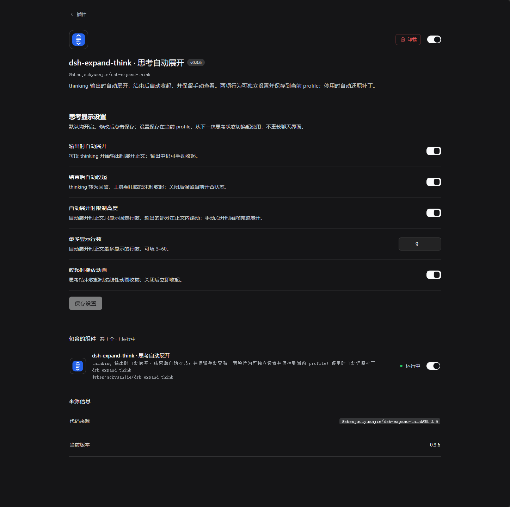

# dsh-expand-think

[](./LICENSE)

**thinking 输出时自动展开，结束后自动收起，保留手动查看。**

DeepSeek Harness（DSH）插件，包名 `@shenjackyuanjie/dsh-expand-think`，行 id `dsh-expand-think`。安装后在 DSH 插件管理器中管理启用和停用，不需要手动运行补丁脚本。

## 安装与使用

### 安装本地 tgz

在 DSH 插件管理器中选择 `shenjackyuanjie-dsh-expand-think-0.3.7.tgz` 安装，然后启用 **dsh-expand-think · 思考自动展开**。命令行在安装了 DSH 的目录执行，`web` 替换为实际 profile：

```powershell
pnpm dsh plugin --profile web add "D:\路径\shenjackyuanjie-dsh-expand-think-0.3.7.tgz"
```

插件启用或停用时需要应用／撤销一次前端补丁，可能触发一次 Chat 更新；保存开关不触发该流程。

### 从 GitHub Packages 安装

`0.3.7` 在新增 DSH `0.2.2-rc.1` 支持的同时，继续兼容 `0.2.1-rc.2`／`rc.3`／`rc.4`／`rc.5`；五个版本的真实官方 Chat 产物均完成回归。

包已发布到 GitHub Packages：`@shenjackyuanjie/dsh-expand-think`。GitHub 的 npm registry 读取公开包也需要认证，使用具备 `read:packages` 的 classic PAT 在本机登录（不要提交 token）；Username 填 GitHub 用户名，Password 填 PAT：

```powershell
npm config set '@shenjackyuanjie:registry' 'https://npm.pkg.github.com' --location=user
npm login --scope=@shenjackyuanjie --auth-type=legacy --registry=https://npm.pkg.github.com
pnpm dsh plugin --profile web add @shenjackyuanjie/dsh-expand-think@0.3.7
```

**停用或卸载：** 在插件管理器中停用或卸载 `dsh-expand-think`，正常停用会撤销思考区块补丁并通知前端更新。启用期间不要另外运行手工脚本修改 Chat 产物，以免两个管理入口互相覆盖。

## 效果

- 每段 thinking 开始流式输出时自动展开正文；转为回答、工具调用，或流式状态因停止／失败结束时自动收起。
- 不等待整轮任务结束，按单个 thinking 区块的 `running` 状态切换。
- 输出中手动收起后，后续 token 不会反复把它展开；结束后仍可手动展开查看原文。
- 自动展开时可以限制正文高度（默认 9 行，可调 3–60 行），超出部分在正文内滚动，输出期间自动跟随到底部。
- 结束时可以播放 240ms 线性收起动画；手动点开的始终完整展开。
- 历史 thinking 初次显示仍默认折叠。
- 不改变回答内容、工具调用、模型请求或会话记录，也不调用额外模型。
- 外层的“工作步骤展示”和过程分组仍遵循 DSH 原有设置，本插件只管理 thinking 自身的开合。

## 展示


> 上图为界面示意图，非真实运行截图，效果以实际插件行为为准。

## 设置

设置入口：**侧边栏 → 插件 → dsh-expand-think → 思考显示设置**。

下面是 0.3.6 的实际设置页面截图，包含自动开合、限高、行数与收起动画设置：



插件详情页提供四个开关和一个数字输入：四个开关默认均开启，最多显示行数默认为 9。修改后点击 **保存设置**，保存到当前 profile 的 DSH 原生 Config。

| 设置               | 配置字段            | 默认值 | 说明                                                       |
| ------------------ | ------------------- | ------ | ---------------------------------------------------------- |
| 输出时自动展开     | `autoExpand`        | 开启   | 关闭后 thinking 开始时不强制展开，仍可手动打开。           |
| 结束后自动收起     | `autoCollapse`      | 开启   | 关闭后 thinking 结束时保留当时的开合状态。                 |
| 自动展开时限制高度 | `limitHeight`       | 开启   | 关闭后自动展开的正文按内容全高显示；手动展开始终完整显示。 |
| 最多显示行数       | `maxLines`          | 9      | 仅在限高开启时生效，可填 3–60 的整数。                     |
| 收起时播放动画     | `collapseAnimation` | 开启   | 关闭后结束时立即收起，不做过渡。                           |

保存只更新原生配置，不改写 Chat 文件、不触发 Chat 热更新，新值从下一次 thinking 状态切换起生效（页面内保存后会立刻同步高度）。页面提供保存状态、放弃修改和只读提示，版本冲突或保存失败时保留草稿，不假装保存成功。两项开合开关都关闭时仅保留 DSH 原有手动开合，同一输出阶段不会因新 token 到来而反复自动切换。

高度只作用于**自动展开**的那一次：手动点击标题或折叠行展开时，插件会清除限高标记，正文完整显示。输出期间新内容到达时，限高正文自动跟随到底部；读者主动上滚离开底部后不再强行拉回，重新滚到底部即恢复跟随。自动展开后读者手动收起，状态与限高标记一起复位。

收起动画只在收起时播放：正文按当前可见高度线性收拢到 0 并淡出，动画结束后才真正卸载内容，因此不会出现高度跳变。关掉该开关后立即收起。

## 兼容范围与实现方式

支持 **DSH `0.2.1-rc.2`／`0.2.1-rc.3`／`0.2.1-rc.4`／`0.2.1-rc.5`／`0.2.2-rc.1`**，以及对应的 **`@deepseek-ai/dsh-client-ui-chat`** 同版本；五个版本的 `ReasoningRow` 锚点一致，共用同一份补丁。`0.2.1-rc.5` 在创建开合状态后插入了 thinking 正文归一化，因此补丁锚点只取那行创建语句，再额外锚定手动开合回调与展开正文容器两处。更早的宿主版本不再适配，版本不符时停止激活。

已从公开 npm registry 下载并核对 `0.2.2-rc.1` 的 Chat、Client Modules、Settings 和 Plugin Manager 产物：`running` 仍为当前流式尾区块，原生 `useDisclosure` 仍提供布尔 `setExpanded`；Host 的 `clientPath`／`rebuilt`／`onGraphChanged`，Client 的 `configForms.get`／`getSnapshot`／`mutate` 与 `plugins.bundle.config` 插槽仍兼容，无需新增版本分支或改写运行策略。验证步骤与产物校验值见 [rc.1 验证记录](./docs/rc1-validation.md)。

DSH 的 reasoning Body Slot 仅在正文已经展开后挂载，无法控制外层开合，因此采用 Host 插件管理的**磁盘级前端补丁**，不是 DOM 点击模拟：从 `clientModules.clientPath()` 取实际前端产物，校验包版本和唯一代码锚点，原子替换后调用 `clientModules.rebuilt()`，由 DSH 原生 HMR 发布前端新版本。

- **启用／启动：** 应用补丁。
- **停用／卸载／正常退出：** 只反向移除本补丁，保留其他位置的用户修改。
- **其他代码已经修改了补丁内部：** 保留文件并记录诊断，不用旧备份覆盖新代码。
- **进程被强制终止：** 磁盘补丁可能保留；再次启用时会识别并接管。

风险提示：同一台机器上其他 profile 或进程若共用同一份 Chat 前端产物，也可能受到影响，建议只由一个 DSH 实例管理该产物；安装目录需要可写；后续 DSH 版本应重新核对扩展接口和代码锚点。

## 开发与验证

纯 JavaScript，无安装脚本、无编译构建；Client 使用宿主 React，不打包另一份 React；代码风格由 Prettier 统一。

```powershell
pnpm install --frozen-lockfile
pnpm run format:check
pnpm run check
pnpm test
pnpm run pack
```

需要改写格式时执行 `pnpm run format`；生成的归档位于 `dist/`，发行文件白名单由 [package.json](./package.json) 的 `files` 字段控制。也可以把实际安装的 Chat 前端产物路径传给测试，验证真实版本的精确代码锚点：

```powershell
node test.mjs "D:\实际路径\dsh-client-ui-chat\lib\client.js"
```

源码分工：[index.js](./index.js) 负责 Host 生命周期、版本验证、原子写入、HMR 与停用还原，[patch-core.js](./patch-core.js) 负责纯文本补丁、thinking 状态边沿同步、限高/滚动/动画锚点与历史补丁接管，[settings.js](./settings.js) 声明五个原生 volatile Config 字段，[client.js](./client.js) 渲染详情页的开关、行数输入、限高与动画 CSS、保存提示。

56 项回归（默认离线运行通过 55 项，真实产物专用 1 项跳过；传入真实产物后全部执行）覆盖自动开合、四种开关组合、手动选择保留、多区块隔离、历史默认折叠、插件启停、五个受支持宿主版本、限高标记与手动展开清除、行数校验、跟随滚动与收起动画标记、0.3.4／0.3.5 历史补丁的接管与升级、设置保存与版本冲突、保存不产生额外 HMR、只读配置桥接及清理、不注册额外配置 Tool、包名与插槽标识一致、HMR 回调重入、延后挂载、版本拒绝，以及不覆盖其他修改；测试不登录、不调用模型、不挂载 React 或 DOM，生命周期仅修改隔离临时目录；真实产物测试以最小 state/callback 替身执行官方 `useDisclosure`，校验 setter、手动开合与外层版本重置语义。0.2.1 移除保存时重载 Chat 的路径后，两个开关已经使用者重启截图确认；0.3.0 改用新包名后需要重新在页面上复核；0.3.5 起的限高、跟随滚动与收起动画需要实际页面确认。长时间输入框稳定性与浅色主题仍未完成实际页面复核，离线测试不能替代这部分验证。

## 发布

源码公开托管于 [GitHub：shenjackyuanjie/dsh-expand-think](https://github.com/shenjackyuanjie/dsh-expand-think)，包发布在 GitHub Packages 的 `@shenjackyuanjie` scope 下。发布用 `pnpm publish`（`publishConfig` 已固定 registry 与 public 访问）；GitHub 的包可见性不自动继承仓库，首次发布后需在 Package settings 中确认 Public。

以 [GNU GPL-3.0-or-later 许可证](./LICENSE)发布，Copyright (c) 2026 shenjackyuanjie。
